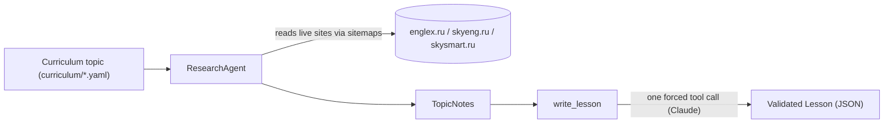

# english-agent

Daily A2 English grammar lessons, researched from curated Russian-language
learning sites and written up by an LLM. The project researches a grammar topic
against live sources, then produces a structured, validated lesson.

## How it works



- **Research** ([src/english_agent/research/](src/english_agent/research/)): an
  agent crawls sitemaps and reads grammar articles from three curated sources
  (`englex.ru`, `skyeng.ru`, `skysmart.ru`), returning structured notes.
- **Writer** ([src/english_agent/writer.py](src/english_agent/writer.py)): turns
  the notes into a validated `Lesson`. Provenance fields (`topic_id`, `cefr`,
  `sources`) are owned by code, so a lesson can never cite a page the research
  step did not read.
- **Pipeline** ([src/english_agent/pipeline.py](src/english_agent/pipeline.py)):
  wires topic -> research -> lesson together.

## Reproducibility (provenance)

Every `Lesson` and `ResearchResult` carries a `provenance` passport so you can
trace exactly how it was produced: the pipeline version, the LLM model id, the
content fingerprints of the prompts used, the data schema version, and the
curriculum version. Component versions live in one place,
[src/english_agent/versions.py](src/english_agent/versions.py). Bump a
`SCHEMA_VERSIONS` entry when a model's shape changes; prompt fingerprints update
automatically from the prompt files.

## Requirements

- Python >= 3.12
- [uv](https://docs.astral.sh/uv/) for dependency management
- An Anthropic API key (Claude)

## Setup

```bash
# 1. Install dependencies into a local .venv
uv sync

# 2. Create your local env file and fill in the API key
cp .env.example .env
# then edit .env and set ANTHROPIC_API_KEY=...
```

Configuration is read from environment variables or a local `.env` file (see
[src/english_agent/config.py](src/english_agent/config.py)). Never commit `.env`.

### Environment variables

| Variable | Required | Default | Description |
| --- | --- | --- | --- |
| `ANTHROPIC_API_KEY` | yes | – | Anthropic (Claude) API key |
| `RESEARCH_MODEL` | no | `claude-haiku-5-5` | Model used by the research agent |
| `WRITER_MODEL` | no | `claude-haiku-5-5` | Model used by the lesson writer |
| `LLM_MAX_TOKENS` | no | `4096` | Max tokens per LLM call |
| `RESEARCH_MAX_STEPS` | no | `12` | Max research agent steps |
| `RESEARCH_MAX_FETCHES_PER_SITE` | no | `2` | Max page fetches per site |
| `RESEARCH_PAGE_CHAR_LIMIT` | no | `40000` | Max chars read per page |
| `SITEMAP_TTL_DAYS` | no | `7` | Days a cached sitemap stays fresh |

See [.env.example](.env.example) for the full template.

## Usage

Topic ids come from [curriculum/a2_topics.yaml](curriculum/a2_topics.yaml).

Run the full pipeline (research + write a lesson):

```bash
uv run python -m english_agent.pipeline --topic there_is_are
```

Run only the research step for one topic:

```bash
uv run python -m english_agent.research --topic present_perfect_vs_past_simple
```

Both commands print JSON to stdout.

## Development

```bash
# Run the test suite
uv run pytest

# Lint, format and type-check
uv run ruff check .
uv run ruff format --check .
uv run mypy
```

See [CONTRIBUTING.md](CONTRIBUTING.md) for the full development workflow
(branching, commit conventions, linting) and [CHANGELOG.md](CHANGELOG.md) for the
release history.

## Project layout

```
src/english_agent/
  config.py        # runtime settings (env / .env)
  paths.py         # repo-relative paths
  pipeline.py      # topic -> research -> lesson
  writer.py        # notes -> validated Lesson
  llm/             # Anthropic (Claude) client
  models/          # pydantic models (curriculum, lesson, golden)
  prompts/         # system prompts
  research/        # research agent, tools, sitemaps, sources
curriculum/        # A2 / B1 topic definitions
evals/datasets/    # evaluation goldens
tests/             # test suite
```

## License

Released under the [MIT License](LICENSE).
