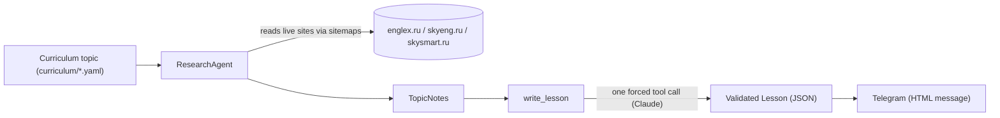
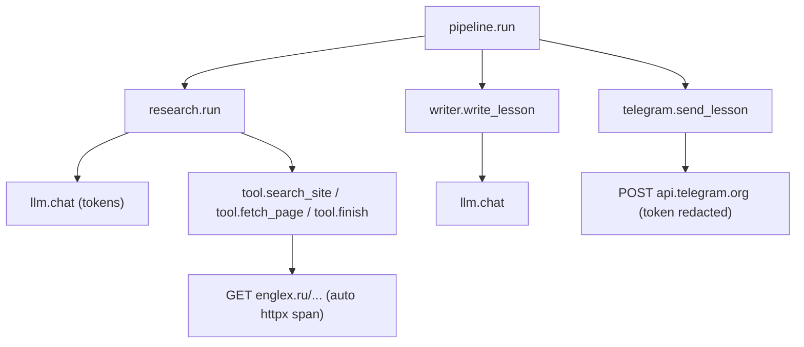

# english-agent

Daily A2 English grammar lessons, researched from curated Russian-language
learning sites and written up by an LLM. The project researches a grammar topic
against live sources, then produces a structured, validated lesson.

## How it works



- **Research** ([src/english_agent/research/](src/english_agent/research/)): an
  agent crawls sitemaps and reads grammar articles from three curated sources
  (`englex.ru`, `skyeng.ru`, `skysmart.ru`), returning structured notes.
- **Writer** ([src/english_agent/writer.py](src/english_agent/writer.py)): turns
  the notes into a validated `Lesson`. Provenance fields (`topic_id`, `cefr`,
  `sources`) are owned by code, so a lesson can never cite a page the research
  step did not read.
- **Telegram** ([src/english_agent/telegram/](src/english_agent/telegram/)):
  renders a `Lesson` as a scannable Telegram HTML message (emoji-anchored
  sections, an always-visible key idea, the detailed theory in a collapsible
  quote, highlighted constructions in bold, sources as links), packed into
  several messages on section boundaries if it exceeds the 4096-character limit,
  and sends it through the Bot API.
- **Pipeline** ([src/english_agent/pipeline.py](src/english_agent/pipeline.py)):
  wires topic -> research -> lesson -> Telegram together.

## Reproducibility (provenance)

Every `Lesson` and `ResearchResult` carries a `provenance` passport so you can
trace exactly how it was produced: the pipeline version, the LLM model id, the
content fingerprints of the prompts used, the data schema version, and the
curriculum version. Component versions live in one place,
[src/english_agent/versions.py](src/english_agent/versions.py). Bump a
`SCHEMA_VERSIONS` entry when a model's shape changes; prompt fingerprints update
automatically from the prompt files.

## Tracing (OpenTelemetry)

The pipeline is instrumented with [OpenTelemetry](https://opentelemetry.io/): one
run becomes a trace whose spans mirror the pipeline, so you can see where time and
tokens go.



Tracing is **off unless `OTEL_EXPORTER_OTLP_ENDPOINT` is set** (see
[src/english_agent/tracing.py](src/english_agent/tracing.py)): with no endpoint
the tracer is a no-op, so CI and normal runs are unaffected. HTTP spans come for
free via `opentelemetry-instrumentation-httpx`; the Telegram bot token is scrubbed
from captured URLs.

Each `llm.chat` span carries token usage, an estimated `gen_ai.usage.cost_usd`, and
a `gen_ai.content.completion` event with *what the model answered* - its text and
tool-call arguments, i.e. the research notes (`finish`) and the finished lesson
(`submit_lesson`). Prompts and fetched page *text* are never put on spans. Because
the capture only happens on recording spans, it costs nothing when tracing is off
(no endpoint configured).

The cost is estimated locally from token counts using the price table in
[src/english_agent/llm/pricing.py](src/english_agent/llm/pricing.py) (the API does
not return a price). Keep that table in sync with Anthropic's pricing; a model that
is not listed there simply gets no cost attribute.

To view traces locally, run [Jaeger](https://www.jaegertracing.io/) with the
provided [docker-compose.yml](docker-compose.yml):

```bash
# 1. Start Jaeger (OTLP collector + storage + UI)
docker compose up -d

# 2. Run the pipeline with tracing on (prints the lesson, does not send it)
OTEL_EXPORTER_OTLP_ENDPOINT=http://localhost:4318 \
  uv run python -m english_agent.pipeline --topic there_is_are --no-send
# drop --no-send to also see the telegram.send_lesson span

# 3. Open the Jaeger UI and pick the "english-agent" service
open http://localhost:16686

# 4. Stop Jaeger when done (in-memory traces are lost)
docker compose down
```

On the server the `app` service already exports to the `jaeger` service of the
same compose stack. To use a hosted OTLP backend such as Grafana Cloud instead,
only the endpoint changes, not the code.

## Requirements

- Python >= 3.12
- [uv](https://docs.astral.sh/uv/) for dependency management
- An Anthropic API key (Claude)
- A Telegram bot token (from [@BotFather](https://t.me/BotFather)) to receive lessons

## Setup

```bash
# 1. Install dependencies into a local .venv
uv sync

# 2. Create your local env file and fill in the API key and bot token
cp .env.example .env
# then edit .env and set ANTHROPIC_API_KEY=... and TELEGRAM_BOT_TOKEN=...

# 3. Open your bot in Telegram and send it /start (bots cannot message you first),
#    then find your chat id and put it into .env as TELEGRAM_CHAT_ID
uv run python -m english_agent.telegram chats

# 4. Check delivery
uv run python -m english_agent.telegram ping
```

Configuration is read from environment variables or a local `.env` file (see
[src/english_agent/config.py](src/english_agent/config.py)). Never commit `.env`.

### Environment variables

| Variable | Required | Default | Description |
| --- | --- | --- | --- |
| `ANTHROPIC_API_KEY` | yes | – | Anthropic (Claude) API key |
| `TELEGRAM_BOT_TOKEN` | for sending | – | Bot token from @BotFather |
| `TELEGRAM_CHAT_ID` | for sending | – | Chat that receives the lessons (`python -m english_agent.telegram chats`) |
| `CURRICULUM_START_DATE` | without `--topic` | – | Day topic 1 is sent (`YYYY-MM-DD`); one topic per day after that |
| `DATABASE_URL` | for sending | – | PostgreSQL URL, `postgresql+psycopg://english_agent:<pw>@localhost:5432/english_agent` (compose sets it for its services) |
| `POSTGRES_PASSWORD` | for compose | – | Password of the compose `postgres` service; use a URL-safe one (`openssl rand -hex 24`) |
| `LESSON_SEND_TIME` | no | `09:00` | When the server app sends the daily lesson |
| `TIMEZONE` | no | `Europe/Moscow` | Time zone for `LESSON_SEND_TIME` and for "today" |
| `LEARNER_CEFR` | no | `A2` | Level of a new learner; the level chosen with /level wins |
| `RESEARCH_MODEL` | no | `claude-haiku-5-5` | Model used by the research agent |
| `WRITER_MODEL` | no | `claude-haiku-5-5` | Model used by the lesson writer |
| `LLM_MAX_TOKENS` | no | `4096` | Max tokens per LLM call |
| `RESEARCH_MAX_STEPS` | no | `12` | Max research agent steps |
| `RESEARCH_MAX_FETCHES_PER_SITE` | no | `2` | Max page fetches per site |
| `RESEARCH_PAGE_CHAR_LIMIT` | no | `40000` | Max chars read per page |
| `SITEMAP_TTL_DAYS` | no | `7` | Days a cached sitemap stays fresh |
| `OTEL_EXPORTER_OTLP_ENDPOINT` | no | – | OTLP/HTTP endpoint for traces (e.g. `http://localhost:4318`); unset disables tracing |

See [.env.example](.env.example) for the full template.

## Usage

Topic ids come from [curriculum/a2_topics.yaml](curriculum/a2_topics.yaml).

Run the full pipeline (research + write a lesson + send it to Telegram):

```bash
uv run python -m english_agent.pipeline --topic there_is_are
```

Add `--no-send` to only print the lesson without sending it. Without `--topic`
the pipeline sends the topic of the day (counted from `CURRICULUM_START_DATE`;
`--date YYYY-MM-DD` checks another day). After the last topic it announces
"курс завершён" once and exits with 0; a failed lesson is reported to the chat.

Sending needs PostgreSQL (`DATABASE_URL`): every sent lesson is recorded in the
`lessons` table, one per learner per day, and a run for a day whose lesson is
already sent does nothing. A failed run is recorded too and is retried by the next
run that day. `--no-send` never touches the database; `--no-store` sends without it.

### Running on the server

Everything runs on the server (`ssh vpn`) as one docker compose stack, see
[docker-compose.yml](docker-compose.yml):

- `postgres` — PostgreSQL 17, data in the `pgdata` volume, published on `127.0.0.1:5432` only;
- `migrate` — runs `alembic upgrade head` once, before the app starts;
- `app` — `python -m english_agent.app`: one long-running process that answers
  /level and /mylevel (long polling) and sends the daily lesson at
  `LESSON_SEND_TIME` in `TIMEZONE`. Started after that time (a restart, a deploy),
  it sends today's lesson right away unless it is already sent;
- `jaeger` — traces from `app`.

```bash
cd ~/english_agent && git pull
docker compose up -d --build      # migrate applies new migrations, then app restarts
docker compose logs -f app
docker compose run --rm --no-deps app python -m english_agent.pipeline --topic there_is_are   # manual run
```

The app must be the bot's only `getUpdates` consumer: do not run
`python -m english_agent.telegram level` against the same bot while it is up.

From a laptop, reach the database and the Jaeger UI through an SSH tunnel:

```bash
ssh -N -L 5432:localhost:5432 -L 16686:localhost:16686 vpn
psql postgresql://english_agent:<pw>@localhost:5432/english_agent
```

### Database

Storage is PostgreSQL through SQLAlchemy 2.0 (sync, psycopg 3), see
[src/english_agent/storage/](src/english_agent/storage/). Repositories return the
pydantic records from [models/storage.py](src/english_agent/models/storage.py);
ORM objects stay inside the package. Tables: `learners`, `lessons` (the lesson
JSON, status and Telegram message ids), and `items`, `errors`, `cards`,
`review_logs`, which later steps (quizzes, FSRS reviews) will fill.

Migrations are managed by [Alembic](migrations/):

```bash
uv run alembic upgrade head                              # apply (DATABASE_URL from .env)
uv run alembic revision --autogenerate -m "add a table"  # then review the generated file
```

The level chosen in the bot used to live in `.state/learner.json`; import it once with

```bash
uv run python -m english_agent.storage import-learner-json            # local file
docker compose run --rm --no-deps -T app python -m english_agent.storage import-learner-json - < .state/learner.json
```

### Backups

[scripts/pg_backup.sh](scripts/pg_backup.sh) writes a `pg_dump -Fc` into
`~/backups/english_agent/` and keeps the 14 newest. The systemd user units in
[deploy/systemd/](deploy/systemd/) run it daily at 03:00:

```bash
mkdir -p ~/.config/systemd/user
cp deploy/systemd/english-agent-backup.* ~/.config/systemd/user/
loginctl enable-linger "$USER"      # run user timers without an open session
systemctl --user daemon-reload
systemctl --user enable --now english-agent-backup.timer
```

Run only the research step for one topic:

```bash
uv run python -m english_agent.research --topic present_perfect_vs_past_simple
```

Both commands print JSON to stdout.

## Development

```bash
# Run the test suite (storage tests are skipped unless DATABASE_URL is exported;
# they work in a throwaway schema, so even a real database is left untouched)
uv run pytest
DATABASE_URL=postgresql+psycopg://english_agent:<pw>@localhost:5432/english_agent uv run pytest

# Lint, format and type-check
uv run ruff check .
uv run ruff format --check .
uv run mypy
```

See [CONTRIBUTING.md](CONTRIBUTING.md) for the full development workflow
(branching, commit conventions, linting) and [CHANGELOG.md](CHANGELOG.md) for the
release history.

## Project layout

```
src/english_agent/
  app.py           # server process: /level bot + daily lesson scheduler
  config.py        # runtime settings (env / .env)
  paths.py         # repo-relative paths
  pipeline.py      # topic -> research -> lesson -> Telegram -> lessons table
  tracing.py       # OpenTelemetry setup (opt-in OTLP export)
  writer.py        # notes -> validated Lesson
  llm/             # Anthropic (Claude) client + token-cost estimate
  models/          # pydantic models (curriculum, lesson, golden, storage records)
  prompts/         # system prompts
  research/        # research agent, tools, sitemaps, sources
  storage/         # PostgreSQL: SQLAlchemy mappings, repositories
  telegram/        # Lesson -> HTML rendering, Bot API client, /level bot
migrations/        # Alembic migrations
deploy/systemd/    # backup timer units
scripts/           # pg_backup.sh
curriculum/        # A2 / B1 topic definitions
evals/datasets/    # evaluation goldens
tests/             # test suite
```

## License

Released under the [MIT License](LICENSE).
