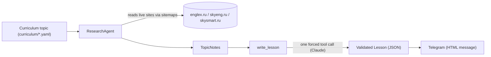
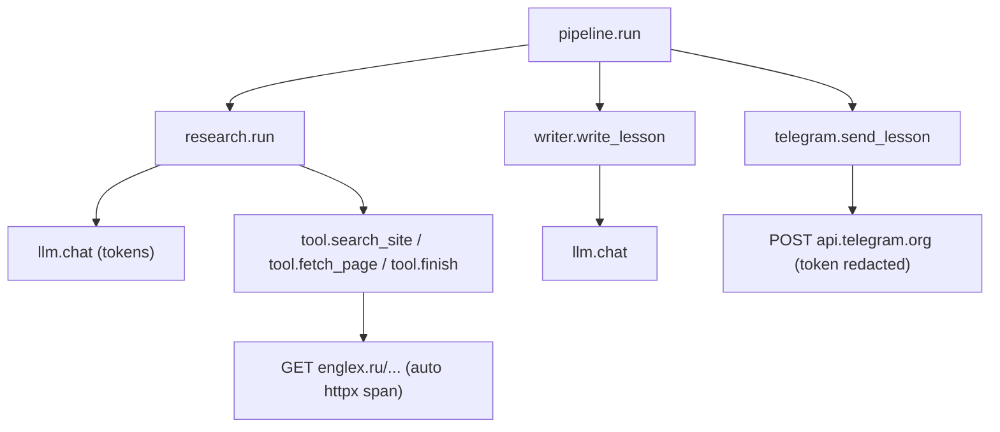

# english-agent

Daily A2 English grammar lessons, researched from curated Russian-language
learning sites and written up by an LLM. The project researches a grammar topic
against live sources, then produces a structured, validated lesson.

## How it works



- **Research** ([src/english_agent/research/](src/english_agent/research/)): an
  agent crawls sitemaps and reads grammar articles from three curated sources
  (`englex.ru`, `skyeng.ru`, `skysmart.ru`), returning structured notes.
- **Writer** ([src/english_agent/writer.py](src/english_agent/writer.py)): turns
  the notes into a validated `Lesson`. Provenance fields (`topic_id`, `cefr`,
  `sources`) are owned by code, so a lesson can never cite a page the research
  step did not read.
- **Telegram** ([src/english_agent/telegram/](src/english_agent/telegram/)):
  renders a `Lesson` as a scannable Telegram HTML message (emoji-anchored
  sections, an always-visible key idea, the detailed theory in a collapsible
  quote, highlighted constructions in bold, sources as links), packed into
  several messages on section boundaries if it exceeds the 4096-character limit,
  and sends it through the Bot API.
- **Pipeline** ([src/english_agent/pipeline.py](src/english_agent/pipeline.py)):
  wires topic -> research -> lesson -> Telegram together.
- **Practice** ([src/english_agent/practice.py](src/english_agent/practice.py),
  [src/english_agent/grader.py](src/english_agent/grader.py)): the writer also
  produces a 3-question quiz and 3 sentences to translate. The quiz goes out as
  Telegram quiz polls `QUIZ_DELAY_MINUTES` after the lesson, the translation task
  at `TRANSLATION_SEND_TIME`; poll answers and the learner's translation are
  stored, wrong answers go to the `errors` table, and the translation is graded
  by `GRADER_MODEL` (corrections and an explanation in Russian, with a button to
  dispute the grade).

## Reproducibility (provenance)

Every `Lesson` and `ResearchResult` carries a `provenance` passport so you can
trace exactly how it was produced: the pipeline version, the LLM model id, the
content fingerprints of the prompts used, the data schema version, and the
curriculum version. Component versions live in one place,
[src/english_agent/versions.py](src/english_agent/versions.py). Bump a
`SCHEMA_VERSIONS` entry when a model's shape changes; prompt fingerprints update
automatically from the prompt files.

## Tracing (OpenTelemetry)

The pipeline is instrumented with [OpenTelemetry](https://opentelemetry.io/): one
run becomes a trace whose spans mirror the pipeline, so you can see where time and
tokens go.



Tracing is **off unless `OTEL_EXPORTER_OTLP_ENDPOINT` is set** (see
[src/english_agent/tracing.py](src/english_agent/tracing.py)): with no endpoint
the tracer is a no-op, so CI and normal runs are unaffected. HTTP spans come for
free via `opentelemetry-instrumentation-httpx`; the Telegram bot token is scrubbed
from captured URLs.

Each `llm.chat` span carries token usage, an estimated `gen_ai.usage.cost_usd`, and
a `gen_ai.content.completion` event with *what the model answered* - its text and
tool-call arguments, i.e. the research notes (`finish`) and the finished lesson
(`submit_lesson`). Prompts and fetched page *text* are never put on spans. Because
the capture only happens on recording spans, it costs nothing when tracing is off
(no endpoint configured).

The cost is estimated locally from token counts using the price table in
[src/english_agent/llm/pricing.py](src/english_agent/llm/pricing.py) (the API does
not return a price). Keep that table in sync with Anthropic's pricing; a model that
is not listed there simply gets no cost attribute.

To view traces locally, run [Jaeger](https://www.jaegertracing.io/) with the
provided [docker-compose.yml](docker-compose.yml):

```bash
# 1. Start Jaeger (OTLP collector + storage + UI)
docker compose up -d

# 2. Run the pipeline with tracing on (prints the lesson, does not send it)
OTEL_EXPORTER_OTLP_ENDPOINT=http://localhost:4318 \
  uv run python -m english_agent.pipeline --topic there_is_are --no-send
# drop --no-send to also see the telegram.send_lesson span

# 3. Open the Jaeger UI and pick the "english-agent" service
open http://localhost:16686

# 4. Stop Jaeger when done (in-memory traces are lost)
docker compose down
```

On the server the `app` service already exports to the `jaeger` service of the
same compose stack. To use a hosted OTLP backend such as Grafana Cloud instead,
only the endpoint changes, not the code.

## Requirements

- Python >= 3.12
- [uv](https://docs.astral.sh/uv/) for dependency management
- An Anthropic API key (Claude)
- A Telegram bot token (from [@BotFather](https://t.me/BotFather)) to receive lessons

## Setup

```bash
# 1. Install dependencies into a local .venv
uv sync

# 2. Create your local env file and fill in the API key and bot token
cp .env.example .env
# then edit .env and set ANTHROPIC_API_KEY=... and TELEGRAM_BOT_TOKEN=...

# 3. Open your bot in Telegram and send it /start (bots cannot message you first),
#    then find your chat id and put it into .env as TELEGRAM_CHAT_ID
uv run python -m english_agent.telegram chats

# 4. Check delivery
uv run python -m english_agent.telegram ping
```

Configuration is read from environment variables or a local `.env` file (see
[src/english_agent/config.py](src/english_agent/config.py)). Never commit `.env`.

### Environment variables

| Variable | Required | Default | Description |
| --- | --- | --- | --- |
| `ANTHROPIC_API_KEY` | yes | – | Anthropic (Claude) API key |
| `TELEGRAM_BOT_TOKEN` | for sending | – | Bot token from @BotFather |
| `TELEGRAM_CHAT_ID` | for CLI runs | – | The chat command-line runs act on (`pipeline`, `telegram ping`, `storage set-schedule`); learners register with /start |
| `CURRICULUM_START_DATE` | for `--no-send` previews | – | Course day 1 (`YYYY-MM-DD`) when previewing the topic of a day |
| `DATABASE_URL` | for sending | – | PostgreSQL URL, `postgresql+psycopg://english_agent:<pw>@localhost:5432/english_agent` (compose sets it for its services) |
| `POSTGRES_PASSWORD` | for compose | – | Password of the compose `postgres` service; use a URL-safe one (`openssl rand -hex 24`) |
| `LESSON_SEND_TIME` | no | `09:00` | A new learner's lesson time (each learner then sets their own with /time) |
| `TIMEZONE` | no | `Europe/Moscow` | A new learner's time zone (/timezone), and "today" for CLI previews |
| `LEARNER_CEFR` | no | `A2` | Level of a new learner; the level chosen with /level wins |
| `QUIZ_DELAY_MINUTES` | no | `60` | A new learner's delay of the quiz polls after the lesson |
| `TRANSLATION_SEND_TIME` | no | `18:00` | A new learner's translation task time (/translation) |
| `PRACTICE_GAP_MINUTES` | no | `60` | Minimum gap between the quiz and the translation task |
| `PRACTICE_CUTOFF_TIME` | no | `22:00` | No practice is sent after this local time |
| `GRADER_MODEL` | no | `claude-haiku-5-5` | Model that grades the learner's translation |
| `GRADER_EFFORT` | no | `high` | Claude API `output_config.effort` for the grader |
| `FSRS_DESIRED_RETENTION` | no | `0.9` | Recall probability the review schedule aims for |
| `FSRS_MAXIMUM_INTERVAL_DAYS` | no | `180` | Longest gap between two reviews of an item |
| `RESEARCH_MODEL` | no | `claude-haiku-5-5` | Model used by the research agent |
| `WRITER_MODEL` | no | `claude-haiku-5-5` | Model used by the lesson writer |
| `LLM_MAX_TOKENS` | no | `8192` | Max tokens per LLM call |
| `RESEARCH_MAX_STEPS` | no | `12` | Max research agent steps |
| `RESEARCH_MAX_FETCHES_PER_SITE` | no | `2` | Max page fetches per site |
| `RESEARCH_PAGE_CHAR_LIMIT` | no | `40000` | Max chars read per page |
| `SITEMAP_TTL_DAYS` | no | `7` | Days a cached sitemap stays fresh |
| `OTEL_EXPORTER_OTLP_ENDPOINT` | no | – | OTLP/HTTP endpoint for traces (e.g. `http://localhost:4318`); unset disables tracing |
| `HTTP_TIMEOUT_SECONDS` | no | `20` | Timeout of research and Telegram HTTP requests |
| `HTTP_USER_AGENT` | no | `english-agent/0.1` | User-Agent of research page fetches |
| `CACHE_DIR` | no | `.cache` | Where sitemaps are cached on disk |
| `LLM_TIMEOUT_SECONDS` | no | `120` | Timeout of one Claude API request |
| `LLM_MAX_RETRIES` | no | `4` | Retries of a Claude API request on 429, 5xx and overloaded, with backoff |
| `LLM_MAX_CONCURRENCY` | no | `3` | Claude API requests one process keeps in flight |
| `DB_POOL_SIZE` / `DB_MAX_OVERFLOW` | no | `5` / `5` | PostgreSQL connections per process, kept open / extra under load |
| `REDIS_URL` | for the worker | – | Redis for the job queue, de-duplication and rate limits, e.g. `redis://localhost:6379/0` |
| `TELEGRAM_GLOBAL_RATE_PER_SECOND` | no | `25` | Outgoing Telegram messages per second, all chats together |
| `TELEGRAM_CHAT_RATE_PER_SECOND` | no | `1` | Outgoing Telegram messages per second to one chat |
| `TELEGRAM_API_BASE` | no | `https://api.telegram.org` | Bot API server (a fake one in load tests) |
| `TELEGRAM_WEBHOOK_URL` / `TELEGRAM_WEBHOOK_SECRET` | no | – | Receive updates by webhook instead of long polling |
| `ADMIN_CHAT_ID` | no | – | Chat that receives operational alerts |
| `LESSON_CATCH_UP_HOURS` | no | `6` | A lesson not sent this long after its send time is not sent that day |
| `JOB_MAX_ATTEMPTS` | no | `5` | Attempts of a failing background job |
| `LESSON_CLAIM_STALE_MINUTES` | no | `10` | A lesson claimed this long ago by a dead worker is taken over |
| `CONTENT_GENERATION_STALE_MINUTES` | no | `20` | A lesson being written this long ago by a dead worker is taken over |
| `LOG_FORMAT` | no | `text` | `json` for one JSON object per line (the server) |
| `LOG_LEVEL` | no | `INFO` | `DEBUG`, `INFO`, `WARNING` or `ERROR` |

See [.env.example](.env.example) for the full template.

## Usage

Topic ids come from [curriculum/a2_topics.yaml](curriculum/a2_topics.yaml).

Run the full pipeline (research + write a lesson + send it to Telegram):

```bash
uv run python -m english_agent.pipeline --topic there_is_are
```

Add `--no-send` to only print the lesson without sending it. Without `--topic`
the pipeline sends the learner's next topic: the first topic of their level, by
order, they have not had yet, so a failed day, a pause or a missed day never loses
a topic. The learner is `TELEGRAM_CHAT_ID` unless `--chat` names another one.
`--no-send` without `--topic` previews the topic of a course day instead, counted
from `CURRICULUM_START_DATE` (`--date YYYY-MM-DD` picks the day). After the last
topic the learner hears "курс завершён" once and stops getting lessons until they
pick another level; a failed lesson is reported to the chat without error details
(those go to the log).

Sending needs PostgreSQL (`DATABASE_URL`): every sent lesson is recorded in the
`lessons` table, one per learner per day, and a run for a day whose lesson is
already sent does nothing. `--no-send` never touches the database; `--no-store`
sends without it.

### Learners and their schedule

Anyone who sends the bot /start becomes a learner and starts the course. Each
learner keeps their own schedule; `LESSON_SEND_TIME`, `TRANSLATION_SEND_TIME`,
`QUIZ_DELAY_MINUTES` and `TIMEZONE` are only what a new learner starts with:

| Command | What it does |
| --- | --- |
| `/start` | Register and start the course (again, after blocking the bot) |
| `/level`, `/mylevel` | Pick or show the CEFR level; progress is kept per level |
| `/time 09:00` | When the daily lesson comes, in the learner's time zone |
| `/translation 18:00` | When the translation task comes (at least `PRACTICE_GAP_MINUTES` after the quiz) |
| `/timezone Europe/Moscow` | The learner's IANA time zone |
| `/pause`, `/resume` | Stop and resume lessons and practice |
| `/status` | The current settings |

A lesson is due from the learner's send time for `LESSON_CATCH_UP_HOURS`
(a restart or a deploy inside that window still sends it); a failed day is not
retried that day, and its topic comes the next day. A learner who blocks the
bot is deactivated until they send /start again. To give an existing learner a
schedule other than the defaults, e.g. the values of an older `.env`:

```bash
uv run python -m english_agent.storage set-schedule --chat 42 --lesson-time 08:30 --timezone Asia/Vladivostok
```

### Running on the server

Everything runs on the server (`ssh vpn`) as one docker compose stack, see
[docker-compose.yml](docker-compose.yml):

- `postgres` — PostgreSQL 17, data in the `pgdata` volume, published on `127.0.0.1:5432` only;
- `migrate` — runs `alembic upgrade head` once, before the app starts;
- `app` — `python -m english_agent.app`: one long-running process that answers
  the bot's commands, quiz answers and translation answers (long polling), checks
  every minute whose lesson is due on their own schedule and every 5 minutes whose
  practice is due; that state is in the database, so a restart neither loses nor
  repeats it;
- `jaeger` — traces from `app`.

```bash
cd ~/english_agent && git pull
docker compose up -d --build      # migrate applies new migrations, then app restarts
docker compose logs -f app
docker compose run --rm --no-deps app python -m english_agent.pipeline --topic there_is_are   # manual run
```

The app must be the bot's only `getUpdates` consumer: do not run
`python -m english_agent.telegram chats` against the same bot while it is up.

Inside the app everything runs on one asyncio event loop: the bot (aiogram 3, long
polling, updates handled concurrently), the lesson and practice ticks (APScheduler's
asyncio scheduler), the database (async SQLAlchemy over psycopg 3) and the Claude
API (one `AsyncAnthropic` client). A slow model call never blocks a reply. Limits:

- at most `LLM_MAX_CONCURRENCY` Claude requests in flight, with SDK retries and a
  per-request timeout;
- outgoing Telegram messages at `TELEGRAM_GLOBAL_RATE_PER_SECOND` in total and
  `TELEGRAM_CHAT_RATE_PER_SECOND` per chat; a 429 is waited out (`retry_after`) and
  retried;
- `DB_POOL_SIZE` + `DB_MAX_OVERFLOW` database connections.

Translation grading runs as a background task of the app; on SIGTERM the app stops
polling, waits up to 90 s for ticks and gradings in progress, then closes the bot,
the Claude client and the pool. A grading cut short stays pending.

From a laptop, reach the database and the Jaeger UI through an SSH tunnel:

```bash
ssh -N -L 5432:localhost:5432 -L 16686:localhost:16686 vpn
psql postgresql://english_agent:<pw>@localhost:5432/english_agent
```

### Database

Storage is PostgreSQL through SQLAlchemy 2.0 (async, psycopg 3), see
[src/english_agent/storage/](src/english_agent/storage/). Repositories return the
pydantic records from [models/storage.py](src/english_agent/models/storage.py);
ORM objects stay inside the package. Tables: `learners` (with each learner's
schedule), `lesson_contents`, `lessons`, the practice tables, and the learner model:

- `lesson_contents` — a lesson written once per topic, level and *recipe* and sent
  to every learner who reaches that topic ([content.py](src/english_agent/content.py)):
  research and writing cost up to ~14 Claude calls, so they run once per topic and
  level, not once per learner. The recipe key combines the lesson schema version,
  the research and writer prompt fingerprints and both models; changing any of them
  makes new content. A claim row makes sure one worker writes it while the others
  wait; a dead worker's claim is taken over after `CONTENT_GENERATION_STALE_MINUTES`,
  a failed attempt is retried after the same cool-down, and a topic whose
  `JOB_MAX_ATTEMPTS` attempts all failed is skipped. Lessons sent before this
  became content keyed `legacy` (migration 0005).
- `lessons` — one per learner and day: status, Telegram message ids and the
  `content_id` that was sent (the lesson JSON is still copied into `payload` too).

- `items` — one core item per taught topic, `<topic_id>:core`, created when the
  lesson is sent ([items.py](src/english_agent/items.py)); the unit that reviews
  and errors attach to.
- `cards`, `review_logs` — FSRS-6 state per learner and item
  ([srs.py](src/english_agent/srs.py), the `fsrs` package with learning steps off).
  Every quiz answer and every graded translation sentence is one rating (correct ->
  good, wrong -> again), applied in the same transaction as the answer; `source_ref`
  makes a replayed event a no-op.
- `errors` — wrong answers and corrected sentences, each pointing at its item.
- `learner_profiles` — append-only versions of the profile
  ([models/profile.py](src/english_agent/models/profile.py)): weak items, error
  patterns and 7-day accuracy, recomputed by code after a finished quiz or a graded
  translation ([profile.py](src/english_agent/profile.py)); `notes_ru` is reserved
  for the Reflector.

Migrations are managed by [Alembic](migrations/):

```bash
uv run alembic upgrade head                              # apply (DATABASE_URL from .env)
uv run alembic revision --autogenerate -m "add a table"  # then review the generated file
```

The level chosen in the bot used to live in `.state/learner.json`; import it once with

```bash
uv run python -m english_agent.storage import-learner-json            # local file
docker compose run --rm --no-deps -T app python -m english_agent.storage import-learner-json - < .state/learner.json
```

Lessons and answers stored before the learner model existed are brought in with
two idempotent commands (run in this order; safe to rerun):

```bash
docker compose run --rm --no-deps app python -m english_agent.storage backfill-items    # core items for sent lessons
docker compose run --rm --no-deps app python -m english_agent.storage backfill-reviews  # link old polls, rate old answers
```

### Backups

[scripts/pg_backup.sh](scripts/pg_backup.sh) writes a `pg_dump -Fc` into
`~/backups/english_agent/` and keeps the 14 newest. The systemd user units in
[deploy/systemd/](deploy/systemd/) run it daily at 03:00:

```bash
mkdir -p ~/.config/systemd/user
cp deploy/systemd/english-agent-backup.* ~/.config/systemd/user/
loginctl enable-linger "$USER"      # run user timers without an open session
systemctl --user daemon-reload
systemctl --user enable --now english-agent-backup.timer
```

Run only the research step for one topic:

```bash
uv run python -m english_agent.research --topic present_perfect_vs_past_simple
```

Both commands print JSON to stdout.

## Development

```bash
# Run the test suite (storage tests are skipped unless DATABASE_URL is exported;
# they work in a throwaway schema, so even a real database is left untouched)
uv run pytest
DATABASE_URL=postgresql+psycopg://english_agent:<pw>@localhost:5432/english_agent uv run pytest

# Lint, format and type-check
uv run ruff check .
uv run ruff format --check .
uv run mypy
```

See [CONTRIBUTING.md](CONTRIBUTING.md) for the full development workflow
(branching, commit conventions, linting) and [CHANGELOG.md](CHANGELOG.md) for the
release history.

## Project layout

```
src/english_agent/
  app.py           # server process: bot + lesson and practice ticks on one event loop
  bot/             # aiogram dispatcher, update handlers, background jobs of the bot
  config.py        # runtime settings (env / .env)
  content.py       # shared lesson content: recipe key, claim owner
  grader.py        # learner's translation -> validated TranslationGrade
  grading.py       # grade a stored answer, save it, show it (bot or job)
  items.py         # sent lesson -> core item in the `items` table (+ backfill)
  logs.py          # logging setup: text or JSON, bound context fields, trace ids
  profile.py       # learner profile: computed from answers, errors and cards; versioned
  srs.py           # spaced repetition (FSRS-6 via py-fsrs): ratings, scheduling
  paths.py         # repo-relative paths
  pipeline.py      # topic -> research -> lesson -> Telegram -> lessons table
  practice.py      # quiz and translation task after the lesson (scheduling, sending)
  tracing.py       # OpenTelemetry setup (opt-in OTLP export)
  writer.py        # notes -> validated Lesson
  llm/             # Anthropic (Claude) client + token-cost estimate
  models/          # pydantic models (curriculum, lesson, practice, golden, storage records)
  prompts/         # system prompts
  research/        # research agent, tools, sitemaps, sources
  storage/         # PostgreSQL: SQLAlchemy mappings, repositories
  telegram/        # HTML rendering, the aiogram sender, outgoing rate limits
migrations/        # Alembic migrations
deploy/systemd/    # backup timer units
scripts/           # pg_backup.sh
curriculum/        # A2 / B1 topic definitions
evals/datasets/    # evaluation goldens
tests/             # test suite
```

## License

Released under the [MIT License](LICENSE).
